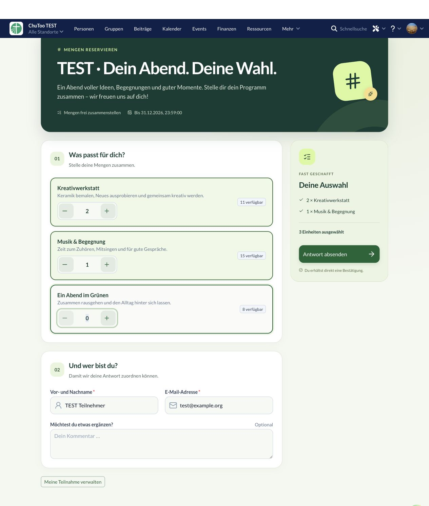

# Design, UI und UX – 0.2.1

Die Oberfläche bekommt eine gemeinsame Gestaltung mit Waldgrün, Lime, warmem Hintergrund, größeren Überschriften und klar gegliederten Karten. Schwerpunkt ist die Teilnahme: erst auswählen, dann Kontaktdaten eingeben und die Antwort mit einer sichtbaren Zusammenfassung absenden.

## Änderungen

- Gemeinsamer Formularkopf für Teilnahme und Entwurfs-Vorschau: Beschreibung, Auswahlmodus, Frist und optionales Umfragebild. Bilder bleiben auf dem Handy sichtbar.
- Nummerierte Formularabschnitte, große Eingaben und Mengenregler, erkennbare Auswahl- und Fokuszustände. Eingaben im Umfrageeditor übernehmen dieselbe Gestaltung.
- Desktop: Zusammenfassung neben dem Formular, beim Scrollen sichtbar. Mobil: Zusammenfassung mit Absendeaktion nach den Eingaben. Die Auswahlzahl wird auch als Screenreader-Status ausgegeben.
- Mengen, Einfachauswahl, Mehrfachauswahl und Termine verwenden konsistente Auswahlkarten. Teilnehmernamen bei Checkboxen sind über eine aufklappbare Liste erreichbar.
- Größere Überschrift und ruhigere Karten in der Übersicht; passender Detailkopf und Editorflächen. Warnungen erhalten eine dunklere Farbe für lesbaren Text.
- Behoben: Checkboxen innerhalb eines gemeinsamen FormField erbten dieselbe ID. Jede Option besitzt jetzt ein eindeutiges Labelziel, auch bei mehreren Formularinstanzen.
- Animationen respektieren die Einstellung für reduzierte Bewegung.

## Verifikation

`npm run check`: TypeScript, ESLint, **44 Tests** und Produktionsbuild erfolgreich. Paketprüfung und `git diff --check` erfolgreich. Version **0.2.1** lokal auf `churchtools.test` installiert.

Live geprüft mit ausschließlich temporären TEST-Umfragen:

- Mengen 2 + 1 ergeben drei Einheiten in der Zusammenfassung; erfolgreiche Speicherung und Antwortbestätigung.
- Ungültige E-Mail-Adresse zeigt eine Fehlermeldung und verhindert die Speicherung.
- Radiokarten per Maus und Pfeiltaste auswählbar; richtige Option in Zusammenfassung und Bestätigung.
- Klick auf das zweite Datumslabel aktiviert ausschließlich die zweite Checkbox. Eindeutige IDs und Beschriftungen im Accessibility-Baum bestätigt.
- Mobil bei 390 und 320 Pixeln: kein horizontaler Überlauf. Name, E-Mail, Mengen und Absendeaktion bleiben bedienbar.
- Übersicht, Detail und Editor live kontrolliert.

Die Screenshots enthalten synthetische Formular- und Umfragedaten. Die temporären Testumfragen 37–40 samt Antworten wurden nach dem Check entfernt; die bereits vorhandene Kategorie #4 ist unverändert. Deren ungültige Altdaten werden weiterhin als Warnung angezeigt. Backend und Link-Token bleiben wie vereinbart unverändert.

## Ansichten

[Mobil 390 Pixel](form-mobile390.png) · [Mobil 320 Pixel](form-mobile320.png) · [Einfachauswahl](form-radio.png) · [Terminauswahl](form-dates.png) · [Übersicht](overview.png) · [Editor](editor.png)
