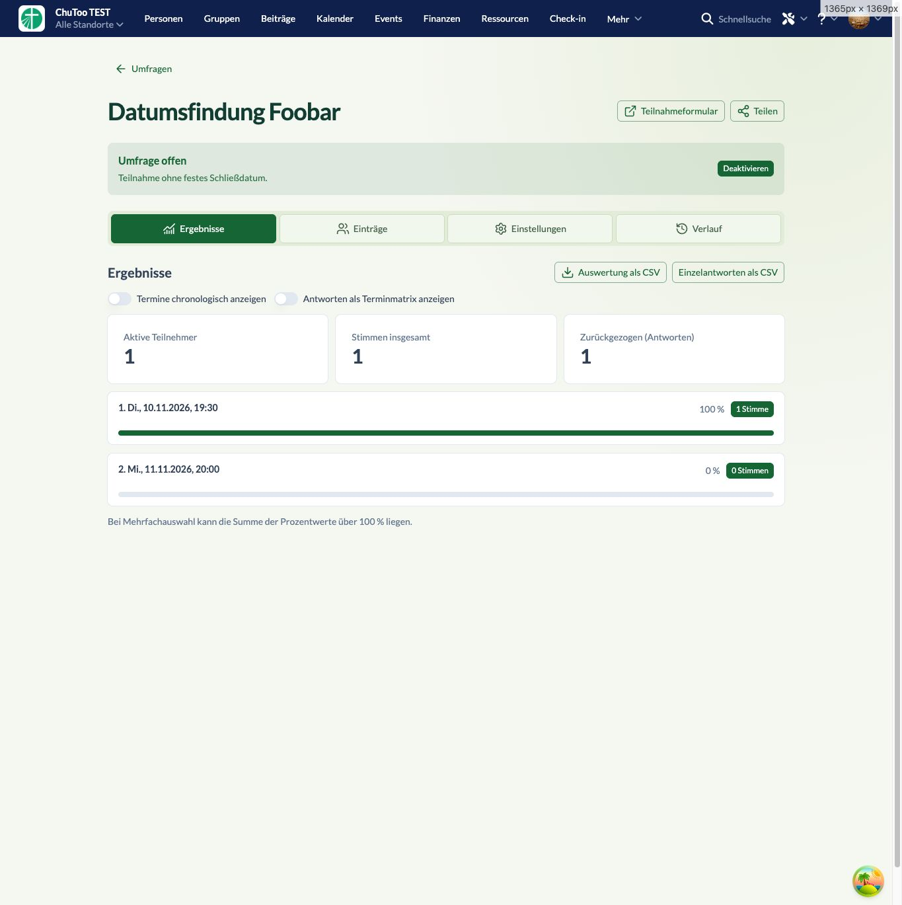

# Detail- und Eintragslayout – 0.2.4

Die 14 Browserkommentare sind umgesetzt:

- Öffentliche Liste: Leerzustand als weiße Karte mit grünem Rahmen.
- Tabs: helle grüne Einzelflächen, dünner Rahmen und kleine Abstände zwischen den Buttons.
- Umfragestatus: deutlichere Überschrift, Aktion rechts neben der Beschreibung.
- Ergebnisse: Prozentwerte nur als Zahl mit Prozentzeichen.
- Einträge: Name und Datum in einer Zeile; Status rechts bei den Aktionen. Kein sichtbares Auswahl-Label mehr, eindeutige zugängliche Namen bleiben erhalten.
- Eintragsaktionen: am Desktop bei Hover oder Tastaturfokus sichtbar. Checkbox nach den Bearbeiten-/Löschen-Icons. Ausgewählte Checkboxen bleiben sichtbar; auf Geräten ohne präzisen Hover bleiben alle Controls erreichbar.
- Dialoge: X am rechten Rand, Footeraktionen rechts. Der Eintragseditor zeigt nur eine Auswahlüberschrift.
- Editor: Vorschau im Inhalt-Kopf, Verwerfen links im Footer; Änderungsstatus und Speichern rechts.

## Verifikation

TypeScript, ESLint, **53 Tests**, Produktionsbuild, Paketprüfung und `git diff --check` erfolgreich. Version **0.2.4** in `churchtools.test` installiert.

Live geprüft: Controls ohne Hover unsichtbar, bei Hover sichtbar, nach Auswahl weiterhin sichtbar. Dialog enthält genau ein „Auswahl“-Label; X und Abbrechen/Speichern sitzen rechts. Vorschau geöffnet, eigener lokaler Testentwurf verworfen und der gespeicherte Stand wiederhergestellt. Die Leerzustandskarte hat einen grünen 1-Pixel-Rahmen. Bestehende Antworten und Umfrageeinstellungen wurden nicht gespeichert oder verändert.

[Editor-Aktionsgruppen](editor.png) · [Leere öffentliche Liste](list-empty.png)
