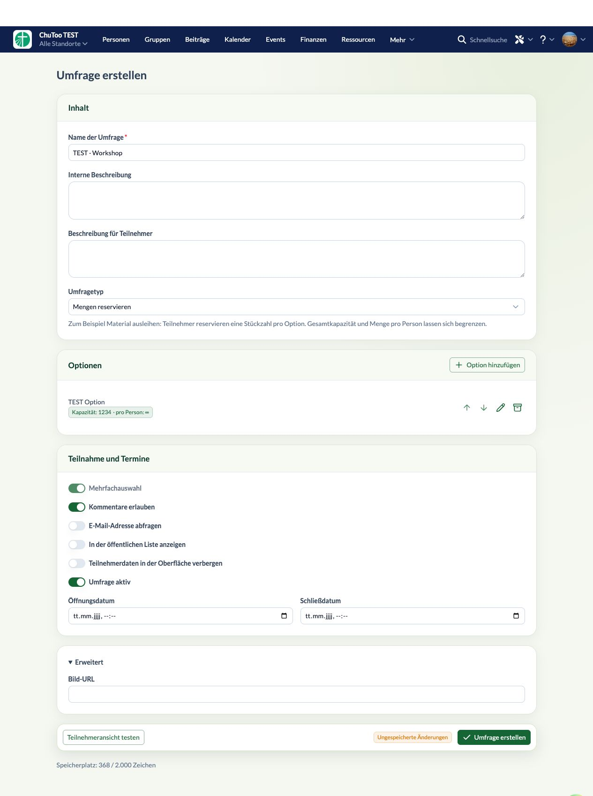

# Editor- und Datenfeedback – 0.2.3

Alle elf markierten Punkte wurden umgesetzt:

| Kommentar | Änderung |
| --- | --- |
| 1, 2 | Eyebrow und Introtext aus der Übersicht entfernt. |
| 3 | Fehler nennen konkrete Datenfelder; betroffene Umfragen erhalten eigene Aktionen für Prüfung/Korrektur, Sicherung und Löschen. |
| 4 | „Teilnahme schließen“ im Kartenmenü, bei deaktivierter Umfrage „Teilnahme aktivieren“. |
| 5 | Heller, dezenter Leerzustand in der öffentlichen Liste. |
| 6 | Editorinputs und Selects sind einheitlich 36 Pixel hoch. Eingaben haben keinen eigenen Hintergrund. |
| 7 | Typbeschreibung sitzt als Feldhilfe direkt unter dem Select. |
| 8 | Zahlenfelder sind kompakt: mindestens vier Stellen plus Buttons, mit zusätzlicher Breite bei längeren Werten. |
| 9 | Modalüberschrift und Schließen-Button sind aufeinander ausgerichtet. |
| 10 | Sortierreihenfolge beim Erstellen ausgeblendet; beim Speichern wird das aktuelle Maximum plus eins vergeben. Im bestehenden Editor weiterhin änderbar. |
| 11 | Nur ein farbiger Änderungsstatus rechts neben Speichern; Entwurf verwerfen ebenfalls in dieser Aktionsgruppe. |

## Ungültige Umfragedaten

Bei Kategorie #4 ist `data` leer. Typ und Optionen fehlen vollständig; eine automatische Migration könnte diese Inhalte nur erfinden. Die Oberfläche erklärt das und erlaubt Wiederherstellung aus einer Sicherung oder manuelle JSON-Korrektur. Das Original kann als JSON-Datei gesichert werden. Löschen nennt die betroffene Umfrage in einer separaten Bestätigung.

Vor einer Korrektur wird der Rohdatenstand erneut geladen und mit dem angezeigten Stand verglichen. Das korrigierte JSON muss eine gültige Umfrage ergeben und zu allen vorhandenen Antworten passen. Unbekannte Optionsbezüge oder ungültige Antworten blockieren die Korrektur. Kategorie-ID und vorhandene Antworten bleiben erhalten.

## Verifikation

- TypeScript, ESLint, **53 Tests**, Produktionsbuild und Paketprüfung erfolgreich.
- Neue Regressionstests für konkrete Diagnosen, automatische Sortierposition einschließlich negativer Werte, erfolgreiche Korrektur mit bestehenden Antworten, unbekannte Optionsbezüge und inzwischen geänderte Rohdaten.
- Version **0.2.3** auf `churchtools.test` installiert.
- Live gemessen: Name und Typselect jeweils 36 Pixel hoch, Hintergrund transparent.
- Zahlenfeld wächst bei längeren Zahlen; vierstellige Werte passen einschließlich Formatierung und Buttons.
- Dialogausrichtung, ein einzelner Änderungsstatus, ausgeblendete Sortierposition, Schließen-Menü und heller Listen-Leerzustand geprüft.
- Leere Korrektur wird abgewiesen. Löschbestätigung für #4 geöffnet und abgebrochen. Bestehende Kategorien und Antworten wurden nicht verändert.
- Testentwurf ausschließlich in separatem Tab; kein Testdatensatz angelegt. Der bereits offene Nutzerentwurf wurde erhalten.

[Übersicht und Fehleraktionen](overview.png) · [Optiondialog](option-dialog.png) · [Datenprüfung](data-diagnosis.png) · [Leere öffentliche Liste](list-empty.png)
