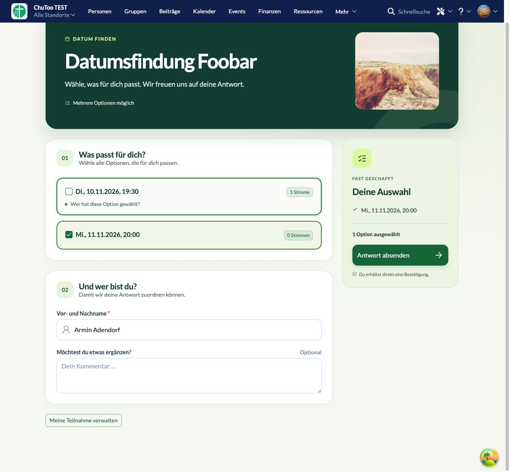

# Teilnehmerformular – 0.2.6

Die drei Browserkommentare sind umgesetzt:

- Der Abstand zwischen Option und aufklappbarer Teilnehmerliste ist auf 4 Pixel reduziert. Die Checkboxzeile hat eine Mindesthöhe von 32 Pixeln.
- Das bestehende Checkboxlabel deckt die ganze Optionskarte ab, einschließlich Rand und Stimmenzahl. Die Teilnehmerliste bleibt darüber unabhängig bedienbar. Mengenfelder behalten ihre eigene Eingabe.
- Titel und Beschreibung haben zusammen 41,5 Pixel Höhe, das Nummernfeld 41,6 Pixel. Mehrzeiliger Text kann weiterhin umbrechen.

TypeScript, ESLint, 53 Tests, Produktionsbuild und Paketprüfung erfolgreich. Version 0.2.6 lokal installiert. Im Browser geprüft: Auswahl über den Kartenrand, Checkbox und Leertaste; Teilnehmerliste ohne Auswahländerung.

Die Prüfung erfolgte in einem separaten Tab, ohne eine Antwort abzusenden. Die bestehende Auswahl im Nutzertab blieb erhalten.

