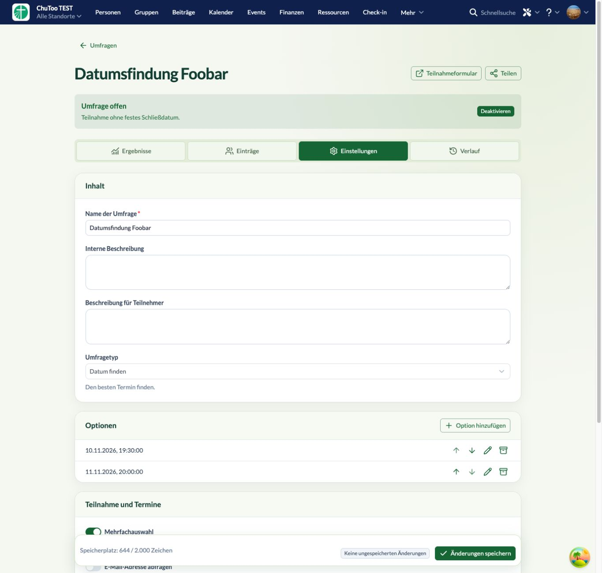

# Abstände und Platzierung – 0.2.5

Die sieben Browserkommentare sind umgesetzt:

1. Übersichtssuche und Statusfilter haben einen weißen Hintergrund; Editoreingaben bleiben transparent.
2. Umfragestatus und Listungsbadge stehen rechts bei den Kartenaktionen.
3. Ergebniszeilen haben 5,6 Pixel Innenabstand zwischen Titelzeile und Balken sowie 16 Pixel äußeres Kartenpadding. Die allgemeine `survey-stack`-Regel hatte zuvor die Utility-Abstände überlagert.
4. Eintragsstatus steht ganz rechts, die Hover-Aktionen und Checkbox darunter.
5. Der Button „Teilnehmeransicht testen“ und die dazugehörige Entwurfsvorschau sind entfernt.
6. Optionszeilen reichen über die gesamte Kartenbreite; Trennlinien gehen bis zum Rand. Die Zeilen haben 8 Pixel vertikales und 24 Pixel horizontales Padding, der Kartenbody kein zusätzliches Padding.
7. Speicherplatzanzeige steht im Sticky-Footer zusammen mit Verwerfen, Änderungsstatus und Speichern.

Kartenstatus und Zwischenräume bleiben Teil der Klickfläche zur Umfrage. Die Buttons haben ihre eigenen Aktionen.

## Verifikation

TypeScript, ESLint, **53 Tests**, Produktionsbuild, Paketprüfung und `git diff --check` erfolgreich. Version **0.2.5** lokal auf `churchtools.test` installiert.

Live bestätigt: Suchhintergrund weiß; Ergebnisgap 5,6 Pixel und Kartenpadding 16 Pixel; Optionszeilen exakt so breit wie der Body; Speicherplatzanzeige im Footer; kein Vorschau-Button; Eintragsaktionen unter dem rechtsbündigen Status. Bestehende Umfragen und Antworten wurden nicht verändert.

[Übersicht](overview.png)
