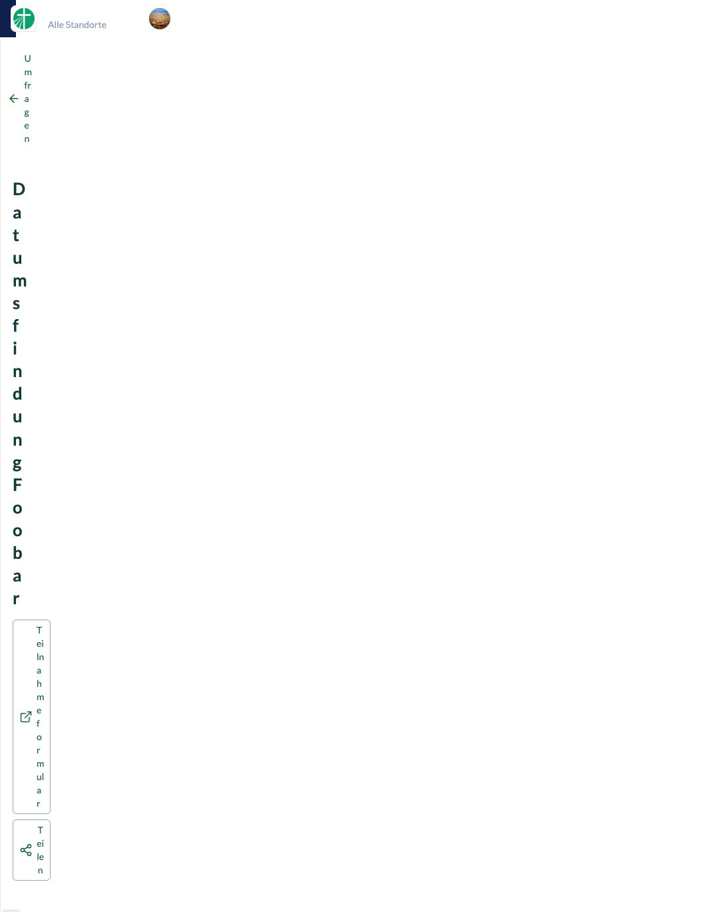

# Browserfeedback – 0.2.2

Die 13 markierten Punkte wurden umgesetzt:

| Kommentar | Korrektur |
| --- | --- |
| 1 | Generiertes Tailwind-/Nuxt-UI-CSS wird über PostCSS auf `#survey` begrenzt. Layer, Tailwind-Properties und Animationen erhalten eigene Namen. Portals liegen ebenfalls innerhalb von `#survey`. Der globale Nuxt-UI-Dark-Mode-Schalter ist deaktiviert. |
| 2, 9 | Keine permanente äußere Outline mehr. Der innere Nuxt-UI-Ring bleibt; Tastaturfokus erhält weiterhin eine sichtbare Markierung. |
| 3 | Gelb-orange Warnfarbe mit heller Fläche statt braunem Vollhintergrund. |
| 4 | Icon und Titel stehen in einer Zeile, Titel in Dunkelgrün. |
| 5 | Kartenpadding auf 16 × 20 Pixel reduziert. |
| 6 | Buttonlinks erhalten auch beim Hover keine Unterstreichung. |
| 7 | Der native Titellink spannt eine Klickfläche über die Karte. Aktionsbuttons liegen darüber und bleiben unabhängig bedienbar. |
| 8 | Detailaktionen sind vertikal zentriert und wachsen nicht mit der Höhe des Titels. |
| 10 | Leicht grüne Tabfläche und grüne Text-/Hoverfarben. |
| 11 | Detailkopf ohne eigene Hintergrundfläche, Rahmen oder Innenpadding. |
| 12 | CSV-Aktionen rechts zusammengefasst und als „Auswertung als CSV“ / „Einzelantworten als CSV“ benannt. |
| 13 | Kompaktere Ergebniszeilen; Prozentwert beziehungsweise verfügbare Kapazität neben Titel und Stimmenzahl. |

Die CSV-Exporte sind unterschiedlich: Die Auswertung enthält aggregierte Stimmen/Mengen und Kapazitäten ohne Teilnehmerdaten. Einzelantworten enthalten die Antwortdatensätze einschließlich Teilnehmerangaben und Status.

## Verifikation

- TypeScript, ESLint, **47 Tests**, Produktionsbuild, Paketprüfung und `git diff --check` erfolgreich.
- Drei neue Tests prüfen CSS-Isolation gegenüber Hostelementen, verschachtelte Regeln sowie globale Property-/Animationsnamen.
- Version **0.2.2** auf `churchtools.test` installiert.
- Live: Kartenfläche öffnet die Umfrage; das separate Aktionsmenü und der Teilen-Dialog funktionieren innerhalb von `#survey`.
- Schrift, Abstände und Höhe der Hostnavigation entsprechen der Referenz ohne Extension. Nach Deaktivierung des globalen Dark-Mode-Plugins ist die Navigation wieder **#0e204b**; die Extension setzt keine `dark`-Klasse am Dokument.
- Kein horizontaler Überlauf bei 390 Pixeln. Viewport anschließend zurückgesetzt.
- Die bestehende Umfrage #41 wurde ausschließlich gelesen; Antworten und Einstellungen blieben unverändert.

[Übersicht](overview.png) · [Mobile Ergebnisse](detail-mobile.png)
